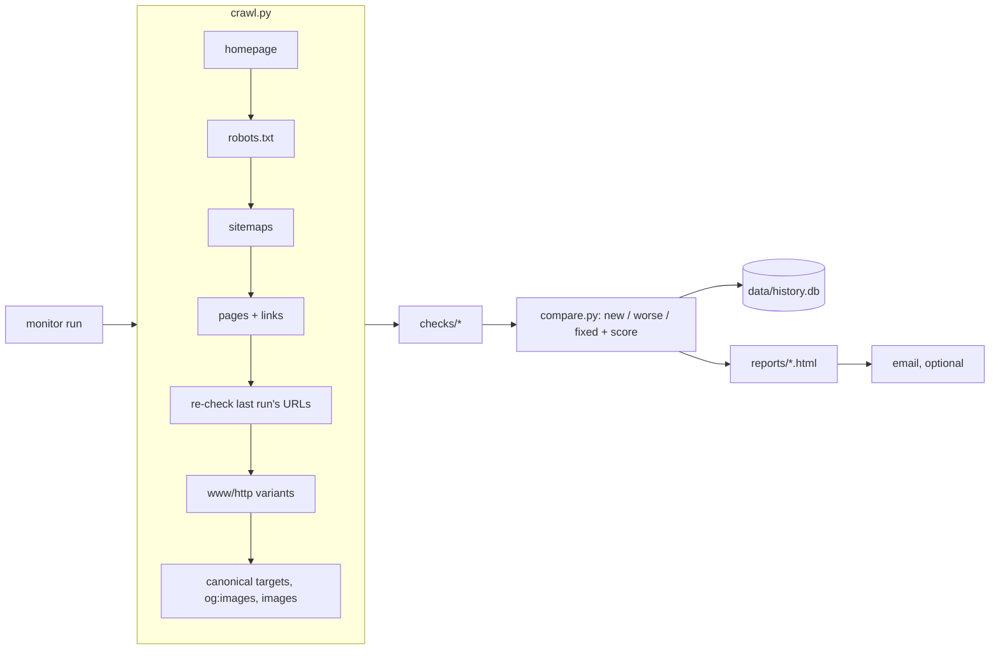

# SEO Monitor

On-demand technical SEO health check for any website. It crawls politely, flags problems in
plain language with a fix for each, and tells you what is **new, worse or fixed** since your
last run of the same site. Nothing runs automatically: you start every audit yourself.

## Install

Needs Python 3.12+ and git.

```bash
git clone <your-repo-url> seo-monitor && cd seo-monitor
python3 -m venv .venv
source .venv/bin/activate          # Windows: .venv\Scripts\activate
pip install -e ".[dev]"
cp .env.example .env               # then set MONITOR_CONTACT (and SMTP if you want email)
```

Run commands from the repo folder. History (`data/`) and reports (`reports/`) are stored there
and are git-ignored, so every device keeps its own history.

## Use

```bash
monitor run https://example.com     # full audit of any site (default 500 pages)
monitor run gtdc                    # a saved profile from sites.yaml
monitor run --all                   # every profile, crawled in parallel
monitor run gtm --quick             # ~1 min: homepage, robots.txt, sitemaps, key URLs + a sample
monitor run gtm --note "after sitemap fix" --email
monitor run example.com -n 100 --delay 2

monitor history                     # past runs with scores
monitor open gtm.com.gh             # reopen latest report for a site (or a run id)
monitor email 12                    # email a saved report
monitor export 12                   # every issue + URL as CSV
monitor checks                      # list all checks
```

Each run opens an HTML report: critical problems in red at the top, then what changed since
the previous run, then every issue with its affected URLs and a fix hint. Press Ctrl-C to stop a
run; partial results are saved and marked incomplete (incomplete runs are never used as the
comparison baseline).

Quick and full runs are compared separately (quick vs previous quick, full vs previous full).
URLs flagged in the previous run are re-visited (up to 200) so fixes can be confirmed; an issue
is only marked fixed if its URL was actually checked again.

## Politeness and safety

- GET requests only; never submits forms or logs in.
- One request per second per host by default (`delay`), and a robots.txt `Crawl-delay` that is
  longer is honoured. robots.txt rules are respected, including `*` and `$` wildcards.
- URLs that can change state even over GET (`add-to-cart=`, `/cart`, `/checkout`, `/wp-admin`,
  login/logout, ...) are never requested. Add more with `skip_patterns`.
- User-Agent: `Mozilla/5.0 (compatible; SEO-Monitor/0.1.0; +MONITOR_CONTACT)` (the standard
  crawler form, as Googlebot uses).

## How broken links are confirmed

A URL is only reported as **broken** when the answer is definite and repeatable:

1. Timeouts, dropped connections, "busy" answers (429, any 5xx such as 508 "resource limit
   reached") and refusals (401/403/406) are retried twice (after 5s and 15s) and that host is
   slowed down. After 3 failures in a row the host is paused (30s, doubling up to 5 min), so a
   struggling server or firewall is not pushed into blocking the crawl.
2. At the end, every failed URL is tested again after a cool-down. A 404/410 must repeat.
   A refusal or server error is pinned on the URL only if, at that moment, a page that loaded
   earlier still loads (a control request); otherwise the server is struggling.
3. **Broken** = repeated 404/410-type answers, refusals confirmed that way, redirect loops and
   certificate errors. Everything else that never answered properly is listed separately as
   **unreachable** (usually hosting load or firewall rate limits), never as a broken link.

The homepage, robots.txt and sitemaps get up to 3 rounds a little apart, so a brief blip in
your own connection does not turn into "robots.txt missing" or "no sitemap". If the homepage
never answers, the report says only that.

## Profiles (`sites.yaml`, optional)

| Setting | Default | Meaning |
|---|---|---|
| `url` | required | Start URL |
| `preferred_host` | where the homepage lands | `www` or `non-www` |
| `sitemaps` | from robots.txt, else common paths | Extra sitemap URLs |
| `key_urls` | `[]` | Always crawled first (paths or full URLs) |
| `max_pages` / `quick_max_pages` | 500 / 40 | Page limits |
| `delay` | 1.0 | Seconds between requests per host (minimum 0.2) |
| `extra_placeholders` | `[]` | Extra demo/template terms to flag (word-boundary match) |
| `placeholder_whitelist` | `[]` | Terms to stop flagging, including built-in ones |
| `junk_sitemap_patterns` | `[]` | Extra URL fragments that must not be in a sitemap |
| `thin_content_patterns` | all pages | Only flag thin content on URLs containing these |
| `skip_patterns` | `[]` | Extra URL fragments never to request |
| `thin_words` / `empty_words` | 150 / 30 | Word thresholds for thin and empty pages |
| `title_max` / `description_max` | 65 / 160 | Length limits |
| `image_max_kb` / `image_checks` | 300 / 150 | Large image threshold / images measured per run |

Running a URL whose domain matches a profile uses that profile's settings.

## Health score

`100 − Σ weight × (0.5 + 0.5 × share of crawled pages affected)` over open issues, with
weights critical 25, high 8, medium 3, low 1. Any critical issue caps the score at 49.

## Email

Set the `SMTP_*` values and `EMAIL_TO` in `.env`. For Gmail, turn on 2-step verification, create
an App Password, and use `smtp.gmail.com` on port 587. The email holds the summary, and the
full report is attached.

## Adding a check

Add a decorated function to a module in `src/seo_monitor/checks/`:

```python
@check("my_check", "medium", "Short title", "Why it matters.", "How to fix it.")
def my_check(ctx: Context):
    for page in ctx.indexable:            # also: ctx.html_pages, ctx.pages, ctx.crawl, ctx.prev
        if something_wrong(page):
            yield Item(page.final_url, "detail shown in the report")
```

Use `key=` on `Item` when the identity across runs is not the URL (for example a footer link
that appears on every page). Add a test in `tests/`. The fake site in `tests/fakesite.py`
reproduces the GTDC audit problems.

## Development

```bash
pytest            # unit tests + end-to-end crawl of an in-memory fake site
ruff check src tests && black --check src tests
```

## How it works


